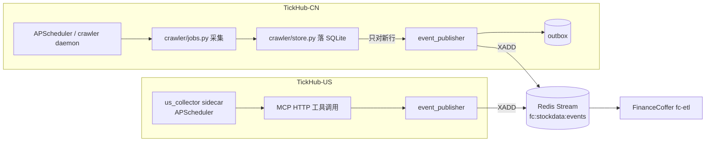

# TickHub 侧改造方案（CN 内嵌钩子 / US 外挂采集器）

版本：v0.2（2026-10-27）
上游契约：`docs/specs/event-contract.md` v0.3
边界：FinanceCoffer 只消费，不做调度、不抓取、不回查上游库。

## 1. 总体结构



两端共用同一套事件格式与同一份发布模块逻辑；差别只在「谁触发采集」。

## 2. 代码事实（改造前核对）

### 2.1 TickHub-CN

| 项 | 事实 |
| --- | --- |
| 爬虫目录 | `src/tickhub_cn/crawler/`：`daemon.py`、`jobs.py`、`runner.py`、`store.py`、`cleaner.py`；**没有 `tasks/` 子目录** |
| 任务集合 | `jobs.py: TASKS = ("announcements", "reports", "risks", "northbound")` |
| 落盘入口 | `store.py`：`insert_announcements` / `insert_reports` / `insert_risks` / `insert_northbound`，均为 `INSERT OR IGNORE`（北向为普通 `INSERT`） |
| 归档库 | `var/archive/tickhub.db`；建了 `kline`、`financial_report`、`shareholder` 表，但**没有代码写入** |
| 调度 | `daemon.py` 用 APScheduler，`OFFLINE_CRAWLER_CRON`（默认 `0 2 * * *`） |
| 缓存 Redis | 已有 `REDIS_URL`（默认 `redis://127.0.0.1:6379/0`） |
| 触发接口 | `POST /api/crawler/run`（`x-admin-token`，admin 默认绑回环 8787） |
| 可观测 | `GET /api/crawler/status`、`/api/crawler/jobs`；`crawl_task`、`source_health` 表 |

结论：钩子必须挂在 `store.py` 的四个 insert 方法上，不能按任务逐个埋点；且**爬虫目前不产出财报与 K 线**。

### 2.2 TickHub-US

| 项 | 事实 |
| --- | --- |
| 包导出 | `tickhub_us.__init__` 只有 `__version__`；**不存在 `StockDataClient`** |
| 工具 | MCP 工具名带 `th_us_` 前缀：`th_us_get_quote`、`th_us_get_market_data`、`th_us_get_financial_statements`、`th_us_search_filings`、`th_us_get_fundamentals` 等 |
| 必填参数 | 每个工具强制显式 `commercial_use: bool`（严格布尔，不接受 `"true"`/`1`） |
| 合规 | `commercial_use=true` 时 B/C/D 级源返回 `E_COMPLIANCE`；返回体带 `source` / `compliance_tier` / `freshness` / `fetched_at` |
| 调度/持久化 | 无 |

结论：sidecar 走 MCP HTTP（稳定契约），不要 import 内部域函数。

## 3. 事件发布模块（两端共用逻辑）

### 3.1 接口

```python
def build_event(
    *, provider: str, data_type: str, symbol: str | None, market: str,
    biz_key: str, event_time: datetime, content: dict,
    source_info: dict | None = None, schema_version: str = "1.0",
) -> dict: ...

def publish(event: dict) -> None:      # 旁路：失败转 outbox，不抛异常给采集
    ...

def flush_outbox(limit: int = 100) -> int: ...
def heartbeat(*, provider: str, market: str, run_id: str, status: str, items: int, ...) -> None: ...
```

### 3.2 `event_id`

```python
def event_id(provider: str, data_type: str, symbol: str | None, biz_key: str) -> str:
    raw = f"{provider}|{data_type}|{symbol or ''}|{biz_key}"
    return "evt_" + hashlib.sha256(raw.encode("utf-8")).hexdigest()[:32]
```

- 用 SHA-256，不用 MD5。
- 时间统一 `datetime.now(timezone.utc)`；`datetime.utcnow()` 在 3.12 起废弃且不带时区。
- `event_time` 填业务时间（公告发布时间/交易日/报告期），另在 `source_info.crawl_time` 记抓取时间。

### 3.3 outbox

```sql
CREATE TABLE IF NOT EXISTS event_outbox (
  event_id      TEXT PRIMARY KEY,
  payload       TEXT NOT NULL,
  created_at    TEXT NOT NULL,
  attempts      INTEGER NOT NULL DEFAULT 0,
  next_retry_at TEXT NOT NULL,
  last_error    TEXT
);
```

- 发布成功即 `DELETE`；主键即 `event_id`，重复入队天然去重。
- 退避 1s/5s/25s/2m/10m，超过 24h 仍失败则保留并告警，不丢弃。
- 刷新时机：每轮任务结束时 + daemon 循环每 5 分钟；不在采集线程里做网络重试。
- 暴露计数：`outbox_pending`、`publish_failed_total`。

### 3.4 Redis 约定

| 项 | 值 |
| --- | --- |
| 地址 | `FC_EVENT_REDIS_URL`，默认 `redis://127.0.0.1:6379/1`（与缓存 db 0 隔离，避免 `FLUSHDB` 误伤） |
| Stream | `fc:stockdata:events`，字段 `payload` |
| 写入 | `XADD fc:stockdata:events MAXLEN ~ 100000 * payload <json>` |
| 持久化 | Redis 必须开 AOF；仅 RDB 会丢最后一段事件 |
| 鉴权 | 非回环部署时启用 `requirepass`/ACL，发布端与 Vault 用同一凭据 |

## 4. TickHub-CN 改造

### 4.1 新增 `crawler/event_publisher.py`

- 复用 `settings.redis_url` 的同机 Redis，但默认写 db 1（见 3.4）。
- 由 `EVENT_PUBLISH_ENABLE`（默认 `false`）控制，关闭时 `publish()` 直接返回。
- 依赖：`redis>=5`（CN 已依赖）。

### 4.2 钩子挂在 `store.py`

在四个 insert 方法内、事务提交后调用。**只发新行**：

```python
def insert_announcements(self, rows, *, source="cninfo") -> int:
    with self.connect() as conn:
        ids = [_item_id(source, r) for r in rows]
        existing = _existing_ids(conn, "announcement", ids)   # 一次 IN 查询
        inserted = _insert_rows(conn, "announcement", rows, ids)
        fresh = [(i, r) for i, r in zip(ids, rows) if i not in existing]
    if EVENT_PUBLISH_ENABLE:
        for item_id, row in fresh:
            event_publisher.publish(event_publisher.build_event(
                provider=source, data_type="announcement", symbol=row["code"],
                market="CN", biz_key=item_id, event_time=_parse(row["ann_date"]),
                content=_announcement_content(row),
            ))
    return inserted
```

四个方法的映射：

| store 方法 | `data_type` | `provider` | `biz_key` |
| --- | --- | --- | --- |
| `insert_announcements` | `announcement` | `cninfo` / `szse` | `_item_id()` |
| `insert_reports` | `research` | `eastmoney` | 研报 ID（无则 `title\|institution\|publish_date`） |
| `insert_risks` | `risk` | `computed` / 公告源 | `occur_date\|risk_type\|ref` |
| `insert_northbound` | `northbound` | `eastmoney_datacenter` | `trade_date\|channel` |

注意：`crawl_announcements` 内部会顺带 `insert_risks(source="computed")`，钩子在 store 层可自动覆盖，无需在 jobs 里重复埋点。

### 4.3 心跳

在 `jobs.py` 的 `TaskResult` 汇总处、每轮 daemon 结束（成功/部分/失败都发）调用 `heartbeat()`：

- `run_id = f"cn-{date}-{task}"`；`status = ok|partial|failed`；`items = result.inserted`。
- 建议另加一个 5 分钟定时心跳（daemon 空闲时也发），用于识别「进程活着但卡住」；与轮次心跳靠 `run_id` 区分。

### 4.4 补齐财报与 K 线（必做，否则 DWD/DWS 无数据）

现有爬虫不写 `financial_report` / `kline`。两种做法：

**推荐：在 CN 爬虫新增两个任务**

| 新任务 | 调用 | 频率 | 说明 |
| --- | --- | --- | --- |
| `financials` | `eastmoney_financial_report(code, statement=income/balance/cashflow, periods=8)` | 每周一次（财报季每日） | 写 `financial_report` 表，按 `report_date\|statement` 去重；`finance_crosscheck` 结果写入 `quality_metrics.balance_check_result` |
| `kline` | `tencent_kline(code, period="day", adjust="qfq")` | 每个交易日收盘后 | 只做日线前复权；首期只覆盖自选池，不做全市场 |

**备选：sidecar 拉取**（与 US 同构）——不改 CN 核心，但会把调度、限流、去重留在外部，长期维护成本更高。

配套：`quote` 事件用 `tencent_quote_batch` 拉自选池收盘快照，作为 PE/PB 的原料（G-05）。

### 4.5 调度

```env
OFFLINE_CRAWLER_ENABLE=true
OFFLINE_CRAWLER_CRON="30 16 * * 1-5"     # 盘后首轮：公告、研报、风险
EVENT_PUBLISH_ENABLE=true
FC_EVENT_REDIS_URL="redis://127.0.0.1:6379/1"
```

- 15:35 偏早：交易所/巨潮公告集中在盘后到晚间，建议 `16:30` 与 `21:00` 两轮（或 `announcements` 单独排晚场）。
- 财报/K 线任务用独立 cron，避免与公告任务抢并发。

### 4.6 验收

- 同一窗口重跑两次，`XLEN` 不增长（`event_id` 幂等 + 只发新行）。
- 停掉 Redis 跑一轮：采集成功；outbox 有记录；Redis 恢复后自动补发。
- `th-cn doctor` 通过；`GET /api/crawler/status` 显示最近一轮 `ok`。

## 5. TickHub-US 外挂 sidecar

### 5.1 形态

独立进程，代码放在 TickHub-US 仓库内的 `us_collector/`（不修改仓库既有代码）：

```text
us_collector/
  scheduler.py     # APScheduler，America/New_York 17:30 工作日
  collector.py     # MCP HTTP 调用 + 事件组装
  publisher.py     # 与 CN 共用逻辑（可复制）
  outbox.py        # SQLite
  config.yaml      # 股票池、工具、cron、compliance（随包发布，--config 省略时默认读它）
```

依赖：`mcp`（客户端）、`apscheduler`、`redis`、`pyyaml`、`tzdata`。**不要**依赖 `tickhub_us` 的导入路径。

启动入口：安装后 `th-us-collector`（`[project.scripts] us_collector.scheduler:main`），源码态 `python -m us_collector.scheduler`；两者退出码一致（锁冲突 2）。

### 5.2 调度

- 时区固定 `America/New_York`，工作日 17:30（收盘后 1.5h），避免夏令时错位。
- 美股节假日：用 `pandas_market_calendars` 或内置节假日表跳过；非交易日只发心跳。
- 单实例锁（文件锁/Redis `SETNX`），防止双开重复调用触发上游限流。
- 用 systemd / Windows 服务托管，禁止裸 `nohup`。

### 5.3 工具映射

| 目标事件 | 工具 | 说明 |
| --- | --- | --- |
| `quote` | `th_us_get_quote` | 收盘快照，PE 原料 |
| `kline` | `th_us_get_market_data(interval="1d")` | 日线 |
| `financial` | `th_us_get_financial_statements` | 三表 |
| `announcement` | `th_us_search_filings` / `th_us_get_filing_feed` | 10-K/10-Q/8-K 元数据 + 链接 |
| `risk` | `th_us_get_insider_trades` / `th_us_get_13f_holdings` | 内部人交易、机构持仓变动，按规则生成风险事件 |

每条事件：

- `source_info.provider` 取返回体的 `source`；`compliance_tier` 取返回体的 `compliance_tier`；`crawl_url` 取 filing 链接。
- `quality_metrics` 继承返回体 `warnings` / `freshness`；缺 `confidence` 时按 `compliance_tier` 映射（S→high，B/C→medium，D→low），不臆造。
- 金额字段转字符串。

### 5.4 `commercial_use` 取值

工具要求显式布尔，且它**只表示用途声明，不是授权开关**：传 `true` 不会拿到更多源，只会触发更严格的拦截。

按 `config/sources.yaml` 的降级链实测，两种取值的覆盖面对比（未配置 Tier B 白名单 / Polygon 商用确认时）：

| 领域 | 链 | `true` | `false` |
| --- | --- | --- | --- |
| `quote_us` 行情 | polygon → sina → tencent → eastmoney | 全拒（Polygon 需订阅 + `TICKHUB_US_POLYGON_COMMERCIAL_BASIS=true`） | 可用（C 级，落 `compliance_tier=C`） |
| `kline_us` K 线 | polygon → sina → yahoo | 全拒（同上） | 可用（C/D 级） |
| `fundamental` 基本面 | eastmoney → yahoo → sec_edgar | 仅 `sec_edgar` 可用 | 全部可用 |
| `financial_statements` 财报 | eastmoney | 拒 | 可用 |
| `key_indicators` 关键指标 | eastmoney | 拒 | 可用 |
| `news` 新闻 | yahoo | 拒 | 可用（D 级，仅个人研究告警） |
| `holders` / `analyst` | yahoo | 拒 | 可用（D 级） |
| `filings` / `fulltext` / `xbrl_facts` / `insider` / `13F` | sec_edgar | 可用（要求署名） | 可用 |
| `short_*` 卖空 | finra | 拒（可用 `TICKHUB_US_ALLOW_TIER_B_SOURCES` 逐项放行） | 可用（B 级，禁止再分发） |
| `macro` / `rates` / `energy` / `taiwan` | 官方源 | 可用 | 可用 |

结论：若选 `true` 且不买 Polygon，US 的行情、K 线、财报、指标、新闻**全部收不到**，US 侧只能落 SEC 官方披露与宏观数据；DWD 的 US 财报快照需改用 SEC XBRL 口径。

取舍建议：

- **内部研究、不对外分发、不提供付费报告** → 用 `false`。每条事件落 `source_info.compliance_tier` + `warnings`，Vault 查询端按级门禁（D 级不出现在对外输出），并保留“仅个人研究”标注。
- **对外商业产品 / 为客户出具分析** → 必须用 `true`，并补 Polygon 订阅（或等价授权源）；接受覆盖缺口，财报用 SEC EDGAR/XBRL 兜底。

**已定（2026-10-26，DEC-0006）：用 `false`。** 配置写死 `FC_COLLECT_COMMERCIAL_USE=false`，不允许运行时切换；每条事件写入 `source_info.commercial_use=false`。后续若转对外商业，必须重新采集，不能用 `false` 口径的历史数据对外输出。

### 5.5 心跳与验收

- 每轮结束发一条 `heartbeat`（`provider=tickhub-us`，`market=US`），`status` 反映本轮失败工具数。
- 验收：断开 Redis 一轮 → 采集结果进 outbox；恢复后补发且 `XLEN` 只增加一次；重复启动第二个实例被锁拒绝。

## 6. 历史回填（一次性）

- 范围：CN 归档库中已有的 `announcement` / `research_report` / `risk_event` / `northbound_flow`。
- 做法：`scripts/backfill_cn.py` 分页读取 SQLite → 复用 `build_event` → `XADD`；带 `source_info.backfill=true` 标记。
- 不在 daemon 中运行；回填完成即停用；已存在的 `event_id` 由 Vault 幂等跳过，可重复执行。
- US 无历史可回填（无持久化），从接入日开始累积。

## 7. Vault 侧配套（不在本文件实现）

- 消费组初始化：`XGROUP CREATE fc:stockdata:events fc-etl $ MKSTREAM`；重启用 `XREADGROUP` 续读；`XAUTOCLAIM` 接管宕机消费者的 pending。
- `heartbeat` 落 `ops.source_heartbeat`，暴露 `fc_source_last_seen_seconds`；不落 ODS。
- 大文本：单条 > 8 MB 拒绝并提示上游改传对象引用。
- 回填与实时事件共用同一校验与幂等路径。

## 8. 任务拆分

| 编号 | 内容 | 归属 | 人日 |
| --- | --- | --- | --- |
| T-101 | CN 发布模块 + store 钩子 + outbox + 心跳 | TickHub-CN | 2 |
| T-102 | CN `financials` / `kline` / `quote` 采集任务 | TickHub-CN | 4 |
| T-103 | US sidecar（调度、工具调用、事件组装、outbox） | TickHub-US | 3 |
| T-104 | 历史回填脚本 + 校验 | 运维 | 1 |
| T-105 | 两端联调（Redis、心跳、断网补发） | 联合 | 1 |

## 9. 风险

| 风险 | 影响 | 对策 |
| --- | --- | --- |
| CN 爬虫限流/反爬 | 财报与 K 线任务失败 | 复用现有代理与退避；首期只覆盖自选池 |
| Redis 未开 AOF | 重启丢事件 | 部署检查项 + `th-cn doctor` / Vault `doctor` 双向校验 |
| 双实例 | 重复调用、限流 | sidecar 单实例锁；CN 只允许一个 daemon |
| 事件体积过大 | Stream 内存膨胀 | 单条 8 MB 上限；`raw_html` 超限截断并标 `truncated` |
| 合规取值错误 | 数据不可商用或覆盖不足 | `commercial_use` 写死配置，查询端按 `compliance_tier` 二次门禁 |
